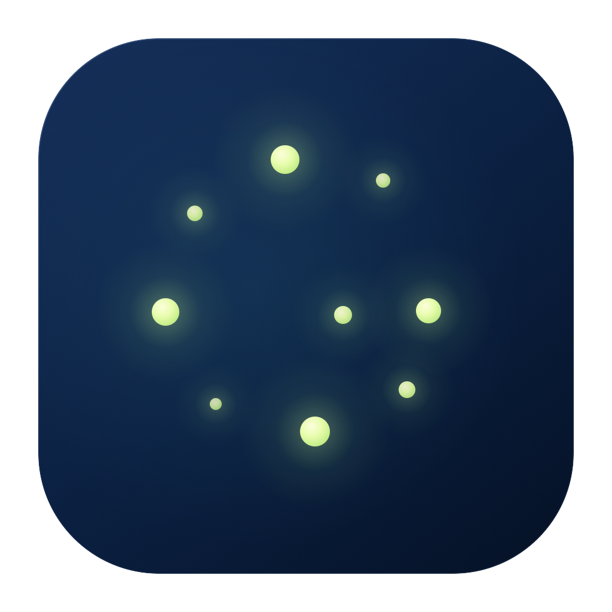

<p align="center">
  
</p>

<h1 align="center">Glimmer</h1>

<p align="center">A live wallpaper app for macOS, built around Apple's Liquid Glass design language with an immersive, minimalist interface.</p>

<p align="center"><a href="README.md">简体中文</a> · English</p>

## Features

- Integrates with the Wallpaper Engine Workshop and supports most Wallpaper Engine features, with further compatibility work in progress.
- Supports multiple types of live wallpaper:
  - Video: full support.
  - Web: broad compatibility.
  - Scene: initial support.
  - Further compatibility improvements are in development.
- Supports native animated lock screens on macOS.
- Imports local live wallpapers.
- Smooth, pleasing transition animations.
- New-version prompts with in-app download and installation after confirmation; reminders can be disabled under Settings → Software Update.
- Additional wallpaper sources and features are in development.

## Installation

Requires an **Apple Silicon Mac (M-series chip) running macOS 26 or later**. The current build targets `arm64`; an Intel version is not available.

1. Download `Glimmer-<version>-arm64.dmg` from this repository's [Releases](https://github.com/BoneInk/Glimmer/releases) page.
2. Open the DMG and drag `Glimmer.app` into **Applications**.
3. Launch Glimmer from **Applications**.

The current development preview is **signed with Apple Development and has not been notarized by Apple**. macOS may block it when first opened on another Mac. Check the corresponding release notes and accompanying `manifest.json` for the package's signing status.

In-app updates require a version that includes this feature; existing users must upgrade manually once. Future updates appear in a prompt and are downloaded and installed within the app after confirmation, without opening a web page. Manual update checks remain available when reminders are disabled. Maintainer signing and publishing steps are documented in the [in-app update guide](docs/auto-updates.md) (Chinese).

### Pause for Maximized Windows and Accessibility Permission

**Pause when a window is maximized** is off by default. When enabled, a full-screen app or a window filling a display’s usable desktop area pauses only that display’s wallpaper. Other displays continue playing.

1. In Glimmer, open **Settings → Power and Sleep Policies** and enable **Pause when a window is maximized**.
2. Select **Authorize Accessibility** to open macOS **System Settings → Privacy & Security → Accessibility**.
3. Enable Glimmer. If it is missing, select **+**, add `/Applications/Glimmer.app`, and return to Glimmer.

This permission lets Glimmer observe changes to window size, position and visibility, reducing unnecessary checks. The feature uses Accessibility events and system notifications without periodic window polling. Without permission, or after permission is revoked, this pause policy is inactive; other wallpaper features remain available.

Moving or shrinking the window, or using **Click wallpaper to reveal desktop**, allows playback to resume according to the automatic-resume setting. Manually paused wallpapers stay paused.

## Getting Started

### Using Local Files

1. Open the library and click the **+** import menu in the upper-right corner.
2. Choose **Video Files or Folder…**, **Web Wallpaper Project…**, or **Scene Wallpaper Project…**.
3. After importing, open the wallpaper's details, preview it, select a target display, and click **Set as Wallpaper**.

For Web and Scene wallpapers, select the complete project folder containing `project.json` and its associated resources. To import existing Steam content, choose **Import from Local Steam Library…**.

### Using the Workshop

Before using the Wallpaper Engine Workshop, sign in to your Steam account within Glimmer and make sure that the account owns Wallpaper Engine. Download and favorites records are stored locally and are not synced to the cloud.

Wallpaper details use equally sized panels: creator information, a description summary and wallpaper actions on the left, with playback or author settings on the right. Select the **i** button beside Lock Screen to read the full description, creator information, tags and public statistics. Select the creator avatar or name to open a Workshop-style grid of their public works, with pagination, previews and downloads. Returning from a work preserves the list page, and downloaded works open their local preview. A visible Workshop preview switches to the same local detail layout once its download is imported successfully; it does not navigate if you have gone back or selected another work. Local projects show their available description; Steam creators are only resolved when a Workshop item ID is associated.

Selecting the creator avatar starts the works request immediately and moves the avatar from the detail panel to its measured position in the list header, without returning the wallpaper to its source card. Reduce Motion displays the creator page directly.

## Wallpaper Compatibility

| Type | Current Support | Notes |
| --- | --- | --- |
| Video | Local import, looping playback, multiple displays, mute and volume controls | Decoding support depends on AVFoundation. Playability is checked during import; videos retain their source frame rate |
| Web | Complete project import, desktop playback, author-defined settings | Compatibility depends on the web capabilities used by the project; the shared FPS cap limits page animation callbacks and is also delivered to the author interface. Embedded video, CSS animations and timers retain their own clocks |
| Scene | Original projects and `scene.pkg`, images, text, particles, scripts, shaders, embedded video | Uses a community Metal backend; see the [compatibility matrix](docs/scene-backend-compatibility-matrix.md) for supported capabilities and limitations |

Scene background music is integrated and muted by default. Desktop cursor and left-click input are forwarded without intercepting Finder's original mouse events. Integration audits for 3D models and skeletons, lights, and camera objects are not yet complete. System audio spectrum response and some author-defined properties are not yet integrated. Playback of every Wallpaper Engine project, or an exact visual match with the Windows version, is not guaranteed.

The app displays diagnostics for missing resources, unsupported features, and runtime failures to help identify the cause.

### Experimental Lock Screen

The project includes a system wallpaper extension and a lock screen integration workflow. Scene and Web lock screens use **live rendering**, so clocks, dates and scripts continue updating. Each Web wallpaper has an HTTPS setting in its author controls, shared by desktop, preview and live lock screen. Weather services still need the wallpaper’s own settings, service permissions and compatible CORS rules. Hidden or sleeping surfaces pause; Web documents are released while the last frame is retained and recreated on resume.

Select a display in wallpaper details, then click **Lock Screen** to set its wallpaper independently. Select **All Displays** to apply one wallpaper everywhere. Each display can use a different video, Scene or Web wallpaper.

Applying a lock screen automatically registers and selects the Glimmer system wallpaper extension. No manual selection in System Settings is needed. Applying to one display preserves the other displays' selections.

Settings → Lock Screen Quality offers original, 720p, 1080p, 1440p and 4K resolution limits and a frame rate, or synchronization with the desktop render size and frame rate. Rendering preserves aspect ratio and never exceeds the source dimensions or frame rate. Scenes use their project canvas; responsive Web content without declared dimensions uses the display render size. Native video wallpapers play their source media, with format conversion or downscaling when needed. Reapply the lock screen after changing quality settings or author properties.

This functionality relies on undocumented macOS system interfaces and is still being validated. Successful asset preparation does not establish that the system lock screen displays it correctly, nor does it imply support for animated wallpapers on the startup or FileVault login screen. See the [extension documentation](Extensions/GlimmerWallpaperExtension/README.md) for implementation details and the scope of validation.

## Building from Source

Requires an Apple Silicon Mac, macOS 26+, a full Xcode installation with the macOS 26+ SDK, and Python 3.

The complete Scene backend also requires a valid code-signing identity already present in your keychain; ad-hoc signing is not supported. The scripts automatically select the Apple Development identity if exactly one is available. If multiple identities are available, specify one using `GW_SIGNING_IDENTITY`.

Run the following commands from the project root:

```bash
# Prepare the project-local .NET SDK and pinned SteamKit2 source
./scripts/prepare-dependencies.sh

# Optional: run Swift type checking and strict concurrency checks for the main app
./scripts/build-app.sh --typecheck

# Build the complete app at build/Glimmer.app
./scripts/build-app.sh

# Package a development preview DMG in dist/
./scripts/package-release.sh

# Verify the packaged artifact
./scripts/package-release.sh --verify dist/Glimmer-0.17.0-arm64.dmg
```

Dependency preparation writes to the project's `.tools/` directory and verifies pinned versions and archive hashes. The root `Package.swift` supports IDE indexing and auxiliary development tasks; use the scripts above to build the complete app.

See the [development guide](docs/development.md) for environment variables, module tests, and directory details. See the [distribution and packaging guide](DISTRIBUTION.md) for Developer ID signing, Apple notarization, and release package verification.

## Data and Issue Reports

The library and settings are stored locally. Credentials used to resume Steam sessions are stored in the macOS Keychain; the app does not save Steam passwords. User wallpapers, account data, caches, and signing certificates are not distributed with the source code.

When reporting an issue, include your macOS version, chip model, Glimmer version, wallpaper type, steps to reproduce, and any error messages shown in the app. For Workshop content, you can provide a public link or item ID. Do not include passwords, verification codes, or session tokens.

## Acknowledgments and Licenses

Glimmer's Scene backend is based on the community project **OpenWallpaperEngine**. Steam content downloads use **SteamKit2**, and the system wallpaper extension draws on **Phosphene**'s interface implementation. Thanks to the authors of these projects and their dependencies.

Original source code in this project is licensed under the [MIT License](LICENSE). Third-party components retain their respective licenses, including GPL-3.0 for the Scene backend and LGPL-2.1 for SteamKit2; the root MIT license does not cover these components. See [NOTICE.md](NOTICE.md) for full provenance, version, and license information. The packaging scripts include the corresponding notices and source archives with the app.
