Open Wallpaper Engine
=========

[English](../../README.md) | [Deutsch](README.de.md) | [Français](README.fr.md) | [Español](README.es.md) | [Português (Brasil)](README.pt-BR.md) | [Italiano](README.it.md) | [日本語](README.ja.md) | [한국어](README.ko.md) | [简体中文](README.zh-Hans.md) | **繁體中文** | [Русский](README.ru.md) | [Polski](README.pl.md) | [Türkçe](README.tr.md) | [Українська](README.uk.md) | [العربية](README.ar.md) | [हिन्दी](README.hi.md)

Open Wallpaper Engine 是一款免費、開源的 macOS App，可播放與編輯 Wallpaper Engine 的場景、影片與網頁背景圖片。場景使用原生 Metal 渲染器繪製，支援特效、粒子、3D 模型、光照、SceneScript 與音訊響應視覺效果，並內建 Steam 工作坊。本專案最初是 Haren Chen 與 MrWindDog 的 [Open Wallpaper Engine](https://github.com/MrWindDog) 的分支，此後已大部分重寫。

> **注意：** 本專案與 Steam 上的商業軟體 Wallpaper Engine 無關。這是一款開源的 macOS App，可顯示來自 Wallpaper Engine Steam 工作坊的背景圖片素材。 → [ATTRIBUTION.txt](../../ATTRIBUTION.txt)

**網站：** [openwallpaperengine.app](https://openwallpaperengine.app/) · **Wiki：** [指南與疑難排解](https://github.com/deepratna-awale/open-wallpaper-engine-mac/wiki)

<!-- demo: desktop -->

[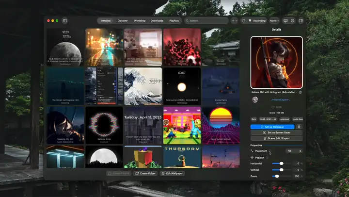](../../docs/media/demo/hero.webm)

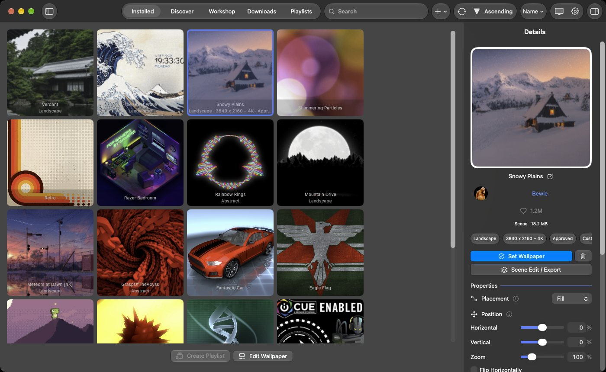

## 與眾不同之處

- **唯一能編輯 Wallpaper Engine 場景的 macOS App。** 背景圖片編輯器可開啟場景的圖層、效果、粒子、時間軸與腳本，並將其儲存為 Wallpaper Engine 背景圖片。
- **原況照片與 Android 版 Wallpaper Engine 輸出。** 任何場景或影片都能變成 iPhone 與 iPad 的動態鎖定畫面，或 Android 版 Wallpaper Engine 的背景圖片套件。
- **轉換 Wallpaper Engine 自己的著色器。** 每個圖層、效果與材質都透過背景圖片的原始著色器繪製，這些著色器會轉換為 Metal，包括工作坊作者自行撰寫的效果。
- **完全即時的螢幕保護程式。** 螢幕保護程式在執行時繪製每台顯示器的背景圖片，因此時鐘、腳本與音訊響應部分會持續動作。不錄製任何內容。

## 特色

- **場景、影片與網頁背景圖片**：場景支援特效、粒子、3D 模型、光源、時間軸、SceneScript 與音訊響應視覺效果，並在能夠顯示 HDR 的顯示器上為場景以及 HDR10 或 HLG 影片提供 HDR 輸出。網頁背景圖片在 WebKit 或選用的 Chromium 引擎中執行，並支援其檔案夾屬性、即時音訊與 Now Playing。
- **Steam 工作坊**：使用 Wallpaper Engine 的排序與篩選方式瀏覽，以你自己的 Steam 帳號透過 SteamCMD 下載，或輸入背景圖片檔案夾與 zip 檔。「已安裝」標籤頁提供 Wallpaper Engine 的檔案夾與排序方式。
- **背景圖片編輯器**：一款延續 Wallpaper Engine 編輯器精神的編輯器。使用操控器加入與排列圖層，加入附預覽的效果，在著色器編輯器中撰寫與編輯你自己的效果，輸入 FBX 與 OBJ 模型，在時間軸上製作動畫，撰寫 SceneScript，建立使用者屬性，編輯粒子系統與 Puppet Warp 骨架，並使用 Wallpaper Engine 的圖像工具（前景分離、建立人物表單、法線貼圖產生）。**新背景圖片⋯** 可從一張圖片或 Wallpaper Engine 的某個範本開始建立背景圖片。你編輯的是一份草稿：**儲存** 會套用它，**儲存為新背景圖片** 會在資料庫中加入一份拷貝，背景圖片本身的檔案絕不會被更改。

  <!-- demo: wallpaper-editor -->

  [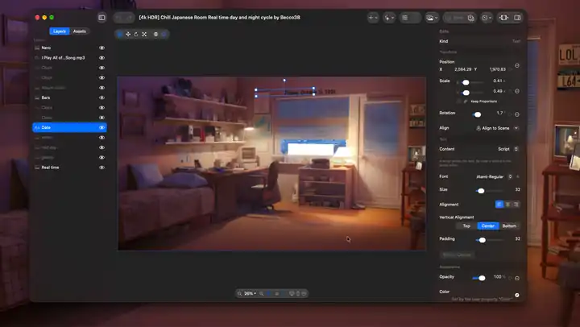](../../docs/media/demo/wallpaper-editor.webm)

  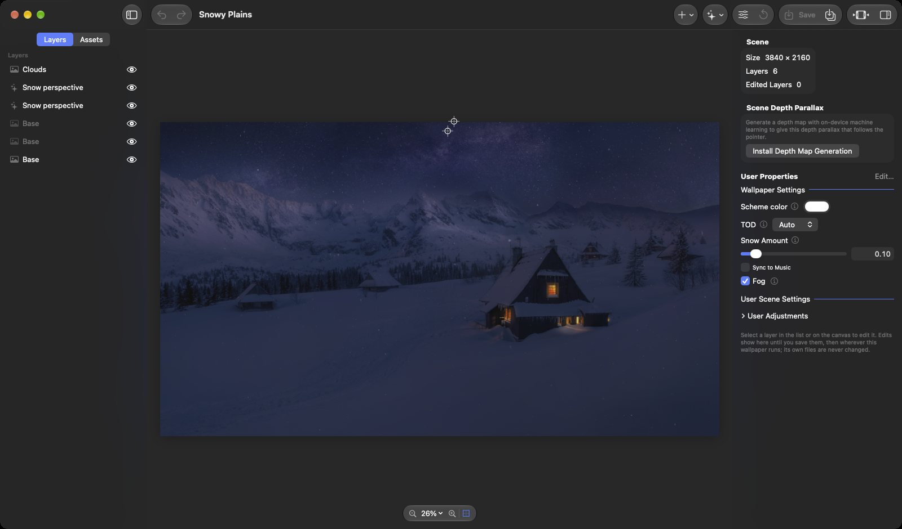

  <!-- demo: model-import -->

  <!-- demo: shader-editor -->

- **場景編輯/輸出**：直接在桌面上即時修改正在執行的背景圖片的圖層與效果，選擇螢幕保護程式顯示的內容，或將背景圖片輸出為原況照片或 Android 套件。

  [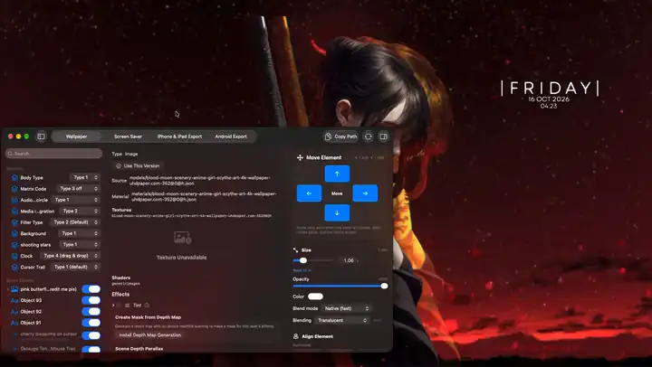](../../docs/media/demo/scene-edit.webm)

  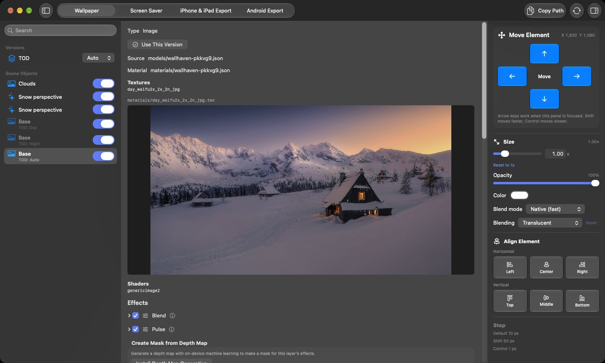

- **螢幕保護程式與鎖定畫面**：螢幕保護程式即時顯示每台顯示器的背景圖片（*螢幕保護程式與桌布相同*），或顯示你選擇的背景圖片；鎖定畫面則顯示它的一張圖片。

  <!-- demo: screen-saver -->

- **輸出**：iPhone 與 iPad 的原況照片鎖定畫面，可透過 AirDrop 傳送或儲存到「照片」；以及 Android 版 Wallpaper Engine 的背景圖片套件，可透過 QR 碼經由 Wi-Fi 傳送到裝置。

  <!-- demo: live-photo-export -->

  [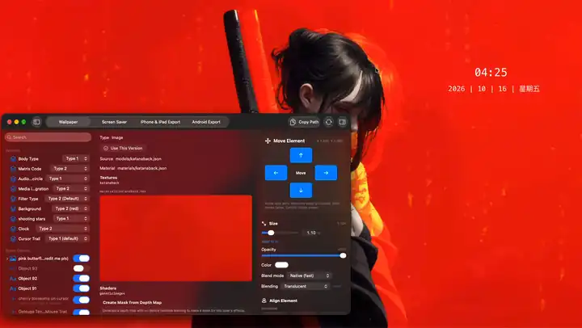](../../docs/media/demo/live-photo-export.webm)

  <!-- demo: android-export -->

  [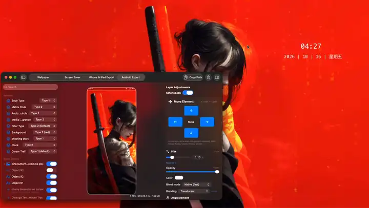](../../docs/media/demo/android-export.webm)

  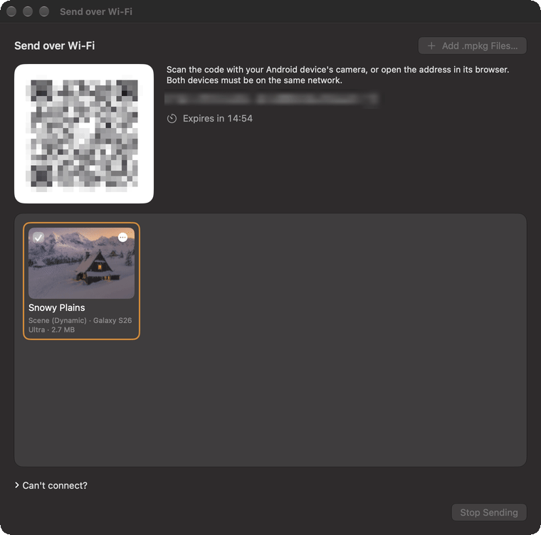

- **顯示器**：與 Wallpaper Engine 相同：每台顯示器一張背景圖片、一張背景圖片橫跨所有顯示器或在每台顯示器上複製，並支援群組、分割與設定檔。**在視窗中播放** 可在獨立的視窗中播放背景圖片。

  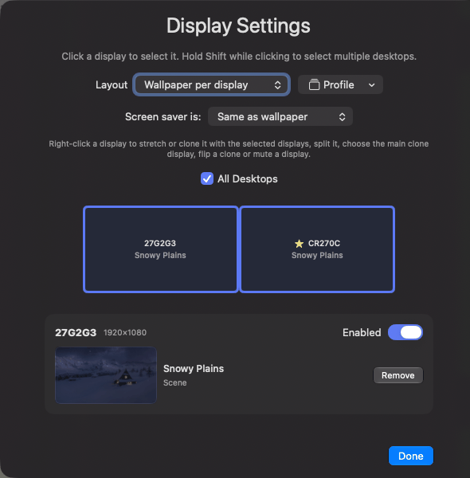

- **播放列表**：依計時器、登入時、一天中的時段或星期幾更換背景圖片，並使用 Wallpaper Engine 的轉場效果。

  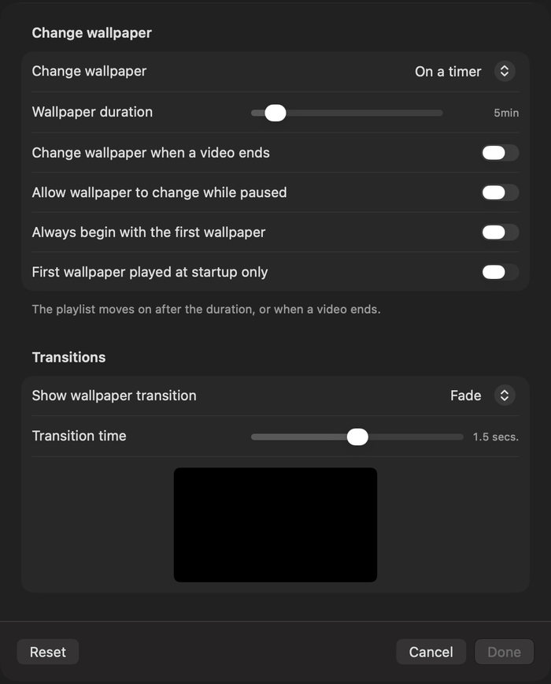

- **控制**：用於動作、播放列表、背景圖片與顯示器設定檔的快速鍵；Wallpaper Engine 的 `-control` [命令列](../../docs/command-line.md)；以及 **MCP 伺服器** 外掛，MCP 用戶端可透過它設定背景圖片、播放列表與設定並編輯場景，連線僅限本機，且只有你的帳號可以開啟。

  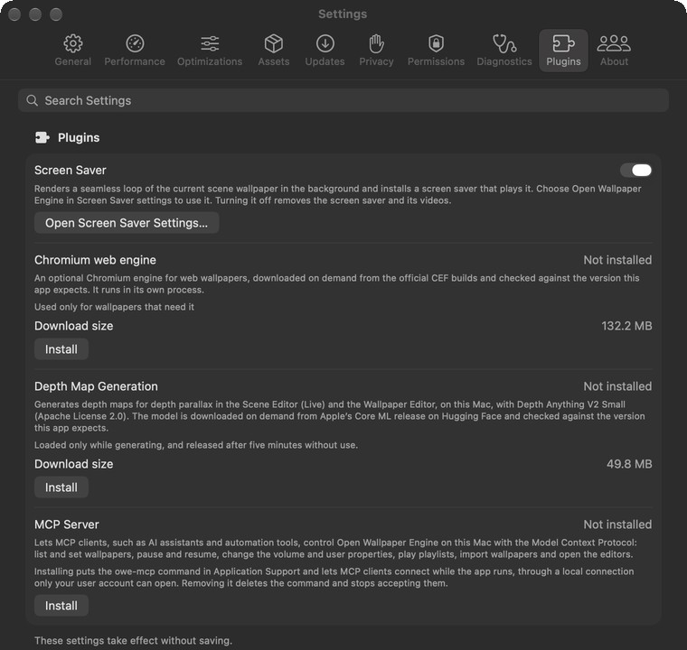

- **電源**：螢幕鎖定時背景圖片會暫停，遵循 Wallpaper Engine 的 *筆記型電腦使用電池時* 規則，並可在使用電池或處於低耗電模式時降至較低的畫質預設與畫面播放速率。
- **主題顏色**：選單列、強調色以及著色的圖像與檔案夾會跟隨背景圖片的顏色變化；Open Wallpaper Engine 自己的視窗可以使用背景圖片的準確顏色。

  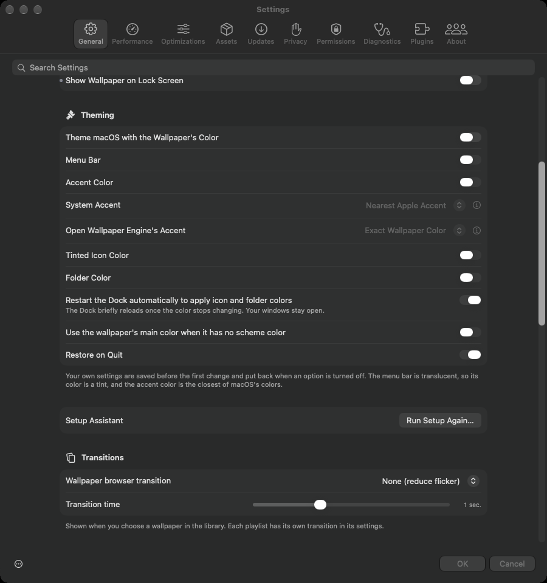

其他所有功能（依領域分類）：[docs/features.md](../../docs/features.md)。

## 安裝

1. 從 [openwallpaperengine.app](https://openwallpaperengine.app/) 或 [GitHub Releases](https://github.com/deepratna-awale/open-wallpaper-engine-mac/releases) 下載最新版本。它已經過簽署與公證，並會自動更新。
2. 打開 DMG，將 **Open Wallpaper Engine** 拖到「應用程式」檔案夾。

需要 **macOS 14.0（Sonoma）或以上版本**。場景背景圖片需要來自你在 Steam 上自己的 Wallpaper Engine 副本的 Wallpaper Engine 素材；影片與網頁背景圖片則不需要。部分功能需要較新的 macOS、某項權限或某個外掛：請參閱[入門指南](../../docs/getting-started.md#requirements)。

## 快速入門

1. 打開 App。設定輔助程式會設定語言、SteamCMD、你的 Steam 登入與 Wallpaper Engine 素材，也可以輸入你的 Wallpaper Engine 喜好項目與檔案夾；每個步驟都可以略過。
2. 如果想使用場景背景圖片，請安裝 Wallpaper Engine 素材（*設定 › 資源*）。這些素材來自你在 Steam 上自己的 Wallpaper Engine 副本；影片與網頁背景圖片不需要它們也能使用。
3. 在 **探索** 與 **工作坊** 標籤頁中尋找背景圖片，輸入背景圖片檔案夾或 zip 檔（*檔案 › 從檔案夾輸入背景圖片…*，⌘I），或使用 **加入背景圖片 › 新背景圖片⋯** 製作一張。
4. 在資料庫中按一下背景圖片，然後在其詳細資訊中按一下 **設定背景圖片**（或按一下右鍵並選擇 **設為背景圖片**）。它的屬性會列在下方。

更多內容：[入門指南](../../docs/getting-started.md)與 [Wiki](https://github.com/deepratna-awale/open-wallpaper-engine-mac/wiki)。

## 隱私權

App 儲存的所有內容都留在你的 Mac 上，它不收集任何資料或分析資訊。它會連線到 Steam（用於工作坊與素材）、openwallpaperengine.app（用於檢查更新）和 GitHub（用於下載更新），外掛只會在你安裝時下載。詳細資訊：[App 會連線到哪些服務](../../docs/getting-started.md#what-the-app-connects-to)以及[隱私權政策](../../docs/legal/privacy-policy.md)。

## 文件

- [入門指南](../../docs/getting-started.md) — 系統需求、素材、工作坊與輸入
- [功能](../../docs/features.md) — App 支援的所有功能及其使用方式
- 指南：[顯示器佈局](../../docs/display-layouts.md) · [播放列表](../../docs/playlists.md) · [螢幕保護程式](../../docs/screen-saver.md) · [iPhone 與 iPad 輸出](../../docs/iphone-ipad-export.md) · [Android 輸出](../../docs/android-export.md) · [深度圖](../../docs/depth-maps.md) · [主題](../../docs/theming.md) · [模型輸入](../../docs/model-import.md) · [圖像工具](../../docs/image-tools.md) · [MCP 伺服器](../../docs/mcp.md) · [命令列](../../docs/command-line.md) · [Chromium 網頁引擎](../../docs/chromium-engine.md)
- [開發](../../docs/development.md) — 從原始碼建置與專案結構；另請參閱 [CONTRIBUTING.md](../../CONTRIBUTING.md) 與[架構](../../docs/architecture.md)
- [Wiki](https://github.com/deepratna-awale/open-wallpaper-engine-mac/wiki) — 指南、設定參考與疑難排解

## 相關專案

- **[Open Wallpaper Engine for Linux](https://github.com/Unayung/simple-linux-wallpaperengine-gui)** — 適用於 [linux-wallpaperengine](https://github.com/Almamu/linux-wallpaperengine) 的 PyQt6 圖形介面，其 Steam 工作坊整合與 UI 設計移植自本 macOS 版本。

## 致謝

本專案建立於以下貢獻者的成果之上：

- **[MrWindDog](https://github.com/MrWindDog)** — 上游 [wallpaper-engine-mac](https://github.com/MrWindDog) 分支的維護者，新增了功能並改善了 UI
- **[Haren Chen](https://github.com/haren724)** — [open-wallpaper-engine-mac](https://github.com/haren724/open-wallpaper-engine-mac) 的原作者，建構了 App 的核心架構（SwiftUI、影片背景圖片播放、輸入系統、播放列表 UI）
- **1ris_W** — 中文 i18n 翻譯
- **[Klaus Zhu](https://github.com/klauszhu1105)** — 原始標誌設計
- **[Chen Chia Yang](https://github.com/Unayung)** — 場景背景圖片渲染、網頁背景圖片修正、Steam 工作坊整合、多顯示器支援、zip 輸入
- **[Deepratna Awale](https://github.com/deepratna-awale)** — Metal 場景渲染器與效果管線、GLSL→MSL 著色器轉換與快取、SceneScript 執行環境、音訊回應式渲染、工作坊／下載功能全面翻新、擺放與效能設定、標誌重新設計

與原始專案相同，本專案採用 [GPL-3.0](../../LICENSE) 授權。

## 法律資訊

[使用條款](../../docs/legal/terms-of-use.md) · [隱私權政策](../../docs/legal/privacy-policy.md) · [安全性政策](../../SECURITY.md)

- **English:** Please read the Terms of Use and the Privacy Policy.
- **Deutsch:** Bitte lesen Sie die Nutzungsbedingungen und die Datenschutzrichtlinie.
- **Français :** Veuillez lire les conditions d’utilisation et la politique de confidentialité.
- **Español:** Lee las condiciones de uso y la política de privacidad.
- **Português (Brasil):** Leia os Termos de Uso e a Política de Privacidade.
- **Italiano:** Leggi le condizioni d’uso e l’informativa sulla privacy.
- **日本語：** 利用規約とプライバシーポリシーをお読みください。
- **한국어:** 이용 약관과 개인정보 처리방침을 읽어 주십시오.
- **简体中文：** 请阅读使用条款和隐私政策。
- **繁體中文：** 請閱讀使用條款和隱私權政策。
- **Русский:** Прочитайте условия использования и политику конфиденциальности.
- **Polski:** Przeczytaj warunki korzystania i politykę prywatności.
- **Türkçe:** Lütfen Kullanım Koşulları’nı ve Gizlilik Politikası’nı okuyun.
- **Українська:** Прочитайте умови використання та політику приватності.
- **العربية:** يُرجى قراءة شروط الاستخدام وسياسة الخصوصية.
- **हिन्दी:** कृपया उपयोग की शर्तें और गोपनीयता नीति पढ़ें।
